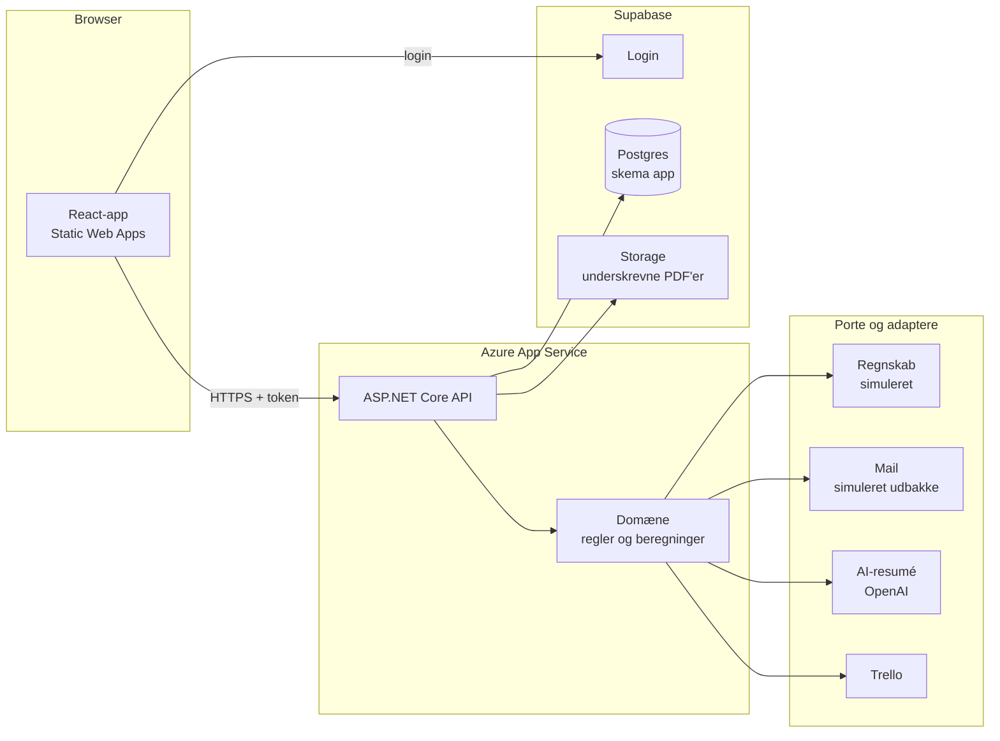
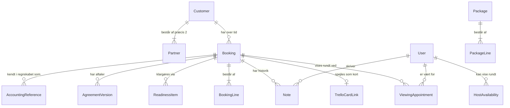

# Byggeplan: Bryllupsbooking til Engestofte Gods

Dette er planen for, **hvordan** systemet bygges. **Hvad** der skal bygges — kunden, processen, problemerne og forretningsreglerne — står i [`projekt-prompt.md`](./projekt-prompt.md). Læs den først; denne plan forudsætter den og gentager den ikke.

## De to repoer

| | Mappe | I Azure DevOps (projekt `EK`) |
|---|---|---|
| Frontend og dokumentation | `~/Repos/WeddingBooking` | `WeddingBooking-frontend` |
| Backend | `~/Repos/WeddingBooking-Backend` | `WeddingBooking-backend` |

De ligger side om side, og sessionen startes fra `~/Repos`, så begge kan læses. Hvert repo har sin egen `CLAUDE.md`, som gælder, når du arbejder i det. Dokumentationen — denne plan og `projekt-prompt.md` — ligger kun i frontend-repoet.

## Sådan arbejder du med planen

1. Læs `projekt-prompt.md` og hele denne plan, før du rører koden.
2. Stil mig **de åbne spørgsmål** (§11), der gælder den fase, du skal i gang med. Har jeg ikke svaret, så byg efter standardantagelsen og skriv den ned.
3. Byg **én fase ad gangen**, fase for fase i den rækkefølge, der står i §9. Hver fase får en feature-branch **med samme navn i begge repoer**, oprettet fra `main`.
4. En fase er færdig, når **hvert punkt under "Færdig når" er opfyldt og vist** — på det deployede site, ikke kun lokalt. Stop der, og vent på mit "go", før du starter næste fase.

---

## 1. Overblik

Et bookingsystem til bryllupper, hvor **hver oplysning tastes ind ét sted**, og alt andet udledes af den. Johan (event manager) opretter et bryllup én gang; kunde, tilbud, betalingsplan, aftalebekræftelse og køkkenets kuverttal følger af sig selv. Det bruges mest fra en computer og skal også kunne bruges fuldt ud fra telefonen.

Regnskabssystemet er **simuleret** i projektet: kunden bruger e-conomic, men vi har ikke adgang. Integrationen ligger bag en grænseflade, så det rigtige system kan sættes ind senere.

---

## 2. Arkitektur

### Formen

En **modulær monolit i to repoer**: en React-frontend og et ASP.NET Core-API. Én database. Alt, der ligger uden for systemet — regnskab, mail, AI, Trello — ligger bag en **port** (en grænseflade i domænet) med en **adapter** pr. rigtigt eller simuleret system.

Det er det rigtige niveau for fem brugere og et par hundrede bookinger om året. Mikrotjenester, CQRS, event sourcing og en besked-bus løser problemer, dette system ikke har, og hver af dem ville koste uger.



### Backend: fire projekter, ét ansvar hver

| Projekt | Rummer | Afhænger af |
|---|---|---|
| `WeddingBooking.Domain` | Entiteter, forretningsregler og de rene beregninger: pris, betalingsplan, status. **Portene** (grænsefladerne mod omverdenen). | Intet |
| `WeddingBooking.Infrastructure` | EF Core og Npgsql, migrationer, filopbevaring i Supabase Storage. | Domain |
| `WeddingBooking.Integrations` | Adapterne: simuleret regnskab, mail, OpenAI, Trello. | Domain |
| `WeddingBooking.Api` | Controllers pr. feature, applikationslogik, adgangskontrol, DTO'er. | Alle tre |

Controllerne er tynde: de validerer input, kalder domænet og mapper til DTO'er. En regel, der afgør et beløb eller en status, bor i `Domain` — så den kan testes uden database og HTTP.

### Frontend

- **React Router** til sider, **TanStack Query** til alt, der hentes fra API'et, **Supabase JS** kun til login.
- Mapper pr. feature (`bookings`, `customers`, `packages`, `readiness`, `notes`, `messages`, `auth`), hver med sine egne `api/`, `components/` og `hooks/`.
- **Typerne genereres fra API'ets OpenAPI-beskrivelse** med `openapi-typescript`. Kontrakten har én kilde, så frontend og backend ikke kan drive fra hinanden, når et felt omdøbes.
- **Computeren først, telefonen med.** Hver side designes til en almindelig computerskærm (1440 px) og tilpasses ned til 375 px, hvor alt stadig skal kunne gøres (fase 9).
- **Det visuelle bygges med skills'ene `ui-ux-pro-max`, `apple-design` og `animate`.** Hvornår hver af dem bruges, står i frontend-repoets `CLAUDE.md`.

---

## 3. Principper

De få regler, der bærer designet. Hver af dem findes, fordi det modsatte var årsagen til Johans problem.

1. **Én sandhed pr. oplysning.** Gæsteantallet findes ét sted, på bookingen. Linjetotaler, bookingens total, raternes beløb og "klar til afholdelse" **udregnes, når de læses**. En gemt total er præcis den mekanisme, der lader 80 og 94 eksistere side om side i dag.
2. **Regnskabet ejer pengene.** Betalingsstatus **læses gennem regnskabsporten** hver gang og gemmes ikke i bookingtabellerne. Systemet gemmer kun *referencer* — kundenummer, tilbudsnummer, fakturanumre.
3. **Priser kopieres ved tilbud.** Når en pakke lægges på en booking, kopieres linjerne og priserne ind på bookingen. En prisstigning næste år ændrer aldrig et tilbud, der allerede er sendt.
4. **Lukket som udgangspunkt.** Hvert endepunkt kræver login, medmindre det udtrykkeligt melder fra (kun `/health`). Adgangskontrol sker ét sted, i API'et.
5. **At være logget ind er ikke det samme som at have adgang.** Enhver med en Supabase-konto på projektet kan få et gyldigt token. Adgang kræver en række i `users`, oprettet af en administrator.
6. **Mennesker sender, systemet foreslår.** Ingen mail forlader systemet uden, at Johan har set teksten og trykket send. AI-resuméet foreslår og viser; det handler aldrig.
7. **Frontenden regner ikke.** Den viser det, API'et har udregnet. To implementeringer af en prisregel giver to svar.
8. **Det offentlige ser kun ledig og optaget.** Bestillingsformularerne er åbne uden login; de viser aldrig et andet pars navn, og alt, de modtager, er en bestilling, et menneske tager stilling til.
9. **Én sag fra første kontakt.** En fremvisning, der bliver til et bryllup, er den samme sag med de samme to personer og den samme historik — ikke en ny.

---

## 4. Datamodel



| Entitet | Vigtigste felter | Bemærk |
|---|---|---|
| **Customer** | de to personer, betaleren | Overlever sine bookinger. Et par, der kommer igen, er samme kunde. Visningsnavnet ("Tobias og Cecilie") **udledes** af de to fornavne og gemmes ikke. |
| **ContactPerson** (personen i parret) | fornavn, efternavn, e-mail, telefon, `isPayer`, `position` (1 eller 2) | **Præcis to pr. kunde**, hver for sig. Højst én betaler; vælges senest, når sagen bekræftes som booking. Betaleren er den, der oprettes i regnskabet. |
| **Booking** | kunde, `kind` (`Viewing`/`Wedding`), `origin` (`Website`/`Staff`/`Trello`), bryllupsdato, **gæsteantal**, `paymentTerms` (`Old`/`New`), salgstrin, oprettet | Gæsteantallet findes kun her. En sag starter som `Viewing` eller `Wedding`; en fremvisning bekræftes til `Wedding` på samme række. |
| **Fremvisning** (i dag `Booking.ViewingAt` + `ViewingHostId`) | tidspunkt, vært; varighed 1 time | Én fremvisning pr. sag, på bookingen. Status (`Requested`/`Confirmed`) kommer med i fase 12, når parret selv kan bestille. |
| **HostAvailability** | vært, ugedag, fra–til, gyldig fra/til | Ugeplanen for, hvornår en vært kan vise rundt. |
| **CalendarBlock** | fra–til, årsag | Ferie, andre arrangementer — tid, der ikke kan bookes. |
| **TrelloCardLink** | booking, Trello-kort-id, board, sidst synkroniseret | Hvilket kort, der hører til hvilken booking. |
| **BookingLine** | beskrivelse, varegruppe, `pricing` (`PerGuest`/`Fixed`), enhedspris, antal | Kopieret fra en pakke eller tilføjet i hånden. |
| **Package / PackageLine** | navn, gyldigt år, linjer med pris | Grundpakke og tilkøb. |
| **ReadinessItem** | kategori, status (`NotStarted`/`InProgress`/`Done`), ansvarlig | Erstatter Trello-kortets grønne felter. |
| **Note** | forfatter, tidspunkt, type (`Call`/`Email`/`Internal`), tekst | Råstoffet til AI-resuméet. |
| **AgreementVersion** | genereret tidspunkt, præciseringstekst, PDF-sti, `signedAt`, underskrevet PDF-sti | Hver genereret version gemmes. |
| **AccountingReference** | type (kunde, tilbud, faktura), eksternt nummer, hvilken rate | Kun referencen — aldrig status eller beløb. |
| **User** | Supabase-id, e-mail, navn, rolle | Rollerne står i §6. |
| **MessageTemplate** | navn, emne, tekst med pladsholdere | Johans tekstbidder. |

**Tekniske konventioner for data:** penge som `decimal` i danske kroner — aldrig `float`. Bryllupsdatoen som `DateOnly`; tidsstempler i UTC. Bookingen har **optimistisk samtidighedskontrol** med Postgres' `xmin`, så to personer, der retter gæsteantallet samtidig, ikke overskriver hinanden i stilhed.

### Udregnet, ikke gemt

- **Linjetotal:** `PerGuest` → enhedspris × gæsteantal; `Fixed` → enhedspris × antal.
- **Bookingens total:** summen af linjerne plus **tillæg for små bryllupper** under 60 gæster (beløbet er konfigurerbart, se §11).
- **Betalingsplanen** — én funktion af betingelser, total og bryllupsdato:

  | Rate | Gamle betingelser | Nye betingelser |
  |---|---|---|
  | Reservationsgebyr | 25.000 kr. ved booking | 25.000 kr. ved booking |
  | 33 %-rate | — | 33 % af totalen, 6 mdr. før |
  | Restbetaling | total − 25.000, 30 dage før | total − 33 %-raten − 25.000, 30 dage før |

  Standardantagelse: gebyret trækkes fra i **restbetalingen** (Johan: *"modregnet i den endelige faktura"*). Hvis svaret på §11.1 er et andet, ændres det ét sted. Raterne summerer altid til totalen.
- **Visningsstatus** — det ene ord, personalet ser. Salgstrinnet gemmes; resten udledes. Det mest presserende vinder:
  1. Afbestilt eller tabt → det.
  2. En rate er forfalden og ubetalt → **Betaling forfalden**.
  3. Datoen er passeret → **Afholdt**, eller **Afventer efterfakturering**, hvis der er tillæg.
  4. Alle klargøringspunkter er færdige → **Klar til afholdelse**.
  5. Reservationsgebyret er betalt → **Dato sikret**.
  6. Ellers salgstrinnet: forespørgsel, fremvisning aftalt, tilbud sendt, underskrevet.

---

## 5. Integrationer

Hver port har en **simuleret adapter**, som systemet kører på i dag, og som vælges i konfigurationen. Den simulerede adapter er produktionskode — det er den, der demonstreres.

### Regnskab — `IAccountingSystem`

Operationer: opret/opdatér kunde, opret tilbud, opret faktura for en rate, hent status og restbeløb på en faktura, hent PDF.

**Den simulerede adapter** bor i sit eget databaseskema, `accounting_sim`, og bookingsystemet ser den kun gennem porten. Den skal:

- tildele fortløbende kunde-, tilbuds- og fakturanumre
- have statusserne kladde → sendt → bogført → betalt
- lave en PDF af tilbud og faktura
- have en admin-handling **"registrér betaling"**, så forløbet kan vises til ende
- efterligne e-conomics rigtige begrænsninger (`projekt-prompt.md`, *Kendte tekniske begrænsninger*): bilag kun på kladder, status hentes frem for at blive skubbet
- være **idempotent**: at oprette samme kunde to gange giver samme kundenummer, ikke to kunder

Brugerfladen viser et mærke, **"Simuleret regnskab"**, overalt hvor der vises regnskabsdata.

### Mail — `IMessageSender`

Ifølge mødet bruger Johan **one.com's webmail** — ikke Microsoft 365. Der er derfor ingen "læg et udkast i hans Outlook". I stedet: systemet fletter en tekstbid med bookingens data, **Johan redigerer teksten i systemet**, og først et eksplicit tryk på *Send* sender den. Den simulerede adapter lægger mailen i en udbakke-tabel; en rigtig adapter kan senere sende via one.com's SMTP. Hver sendt mail logges som en note på bookingen.

### Aftalebekræftelse — `IAgreementRenderer`

PDF'en laves med **QuestPDF** — ren .NET, ingen browser i baggrunden, kører uden videre på App Service. Indholdet flettes fra bookingen (parret, dato, gæsteantal, hver aftalt linje) plus et **præciseringsfelt**, som Johan skriver i pr. booking — det, han i dag gør ved at rette i sit Word-dokument. Tjek QuestPDF's licens før produktion: den er gratis for mindre virksomheder og til undervisning.

### AI-resumé — `ISummariser`

OpenAI via konfiguration; en fast adapter, når der ingen nøgle er. Input: bookingens strukturerede data **plus** noter og indsat mailtekst. Output: fire faste felter — status, aftalt indhold, åbne punkter, sidste kontakt. **Tal (gæsteantal, datoer, beløb) tages fra de strukturerede data**, ikke fra teksten, fordi en sprogmodel, der gætter et gæsteantal ud fra en mailtråd, gætter forkert.

### Trello — `ITrelloGateway`

Bookingerne frem til 2027 ligger i Trello. Første skridt er en **engangsimport**, der kører som tørløb først og rapporterer, hvad den ville importere, og hvad den ikke kan (fase 8).

Derefter **synkroniseres Trello** (§11.6 er besvaret): boardet vises som kanban inde i systemet, og opgaver kan oprettes, flyttes og afkrydses begge steder (fase 14–15).

- **Boardet er offentligt** (§11.16, besluttet). Det læses derfor **uden nøgle** gennem Trellos åbne adresse, `https://trello.com/b/{board-id}.json`. Alle med linket kan læse kortene.
- **At skrive kræver stadig nøgle og token** — oprette, flytte og afkrydse kort og registrere webhooks (fase 15). Trello tillader ingen skrivning uden, heller ikke på et offentligt board. Nøglen og tokenet ligger i API'et.
- **Browseren taler med vores API, API'et med Trello** — også når der læses. API'et samler boardet ét sted, så telefoner og computere ikke hver især spørger Trello, og en adapter bag `ITrelloGateway` kan skifte til læsning med nøgle, hvis boardet senere gøres privat.
- **Trello giver besked med webhooks** til et anonymt endepunkt, der tjekker Trellos signatur. Webhooks kan tabes, så en **periodisk afstemning** henter boardet og retter forskelle.
- **Hvem ejer hvad:** bookingens data (dato, gæsteantal, priser) ejes af systemet og skrives til kortet; kortets egne opgaver og tjeklister kan rettes begge steder, og den seneste ændring vinder (§11.15).

---

## 6. Login, roller og adgang

- **Login er Supabase.** API'et validerer tokens mod `{SUPABASE_URL}/auth/v1` — udstederen er `/auth/v1`, ikke projektets rod — med de ES256-nøgler, Supabase offentliggør der. API'et har ingen delt hemmelighed.
- **En fallback-politik** kræver login på alle endepunkter. Kun disse melder udtrykkeligt fra, og hver af dem er rate-begrænset:
  - `/health`
  - det selvstændige AI-resumé (fase 7)
  - bestillingsformularerne: ledige tider og datoer, og at sende en bestilling (fase 12) — med honeypot-felt mod spam
  - Trellos webhook, som kun modtages med gyldig signatur (fase 15)
- **En middleware** slår den indloggede op i `users` og svarer **403 med en forklaring**, hvis personen ikke findes. Det er det ene sted, forskellen på "logget ind" og "har adgang" håndhæves.
- **Rollerne:**

  | Rolle | Ser | Retter |
  |---|---|---|
  | `EventManager` (Johan) | Alt | Alt |
  | `Owner` (Mette, Lise) | Alt | Alt |
  | `Bookkeeper` | Bookinger, priser, betalinger | Fakturering |
  | `Chef` (Kenneth) | Dato, gæsteantal, menu, allergier — **ingen priser** | Mad og allergier i klargøringen |
  | `EventProducer` (Bryan) | Som kokken, plus opdækning og pynt | Opdækning, pynt, klargøring |

  **Pris- og betalingsfelter fjernes fra svaret** for kok og event producer. At skjule dem i frontenden er ikke adgangskontrol.

---

## 7. Konventioner

### Sprog

**Koden er på engelsk. Brugerfladen er på dansk.** Domænebegreberne har en fast oversættelse, så præcisionen bevares i koden:

| Dansk | Kode |
|---|---|
| Booking | `Booking` |
| Kunde / brudepar | `Customer` |
| Kontaktperson | `ContactPerson` |
| Gæsteantal | `GuestCount` |
| Forespørgsel · fremvisning · tilbud | `Inquiry` · `Viewing` · `Quote` |
| Varegruppe · pakke · tilkøb | `ProductGroup` · `Package` · `AddOn` |
| Reservationsgebyr · rate · restbetaling | `ReservationFee` · `Instalment` · `FinalPayment` |
| Betalingsbetingelser (gamle/nye) | `PaymentTerms` (`Old`/`New`) |
| Aftalebekræftelse | `Agreement` |
| Klargøring · klar til afholdelse | `Readiness` · `ReadyForEvent` |
| Efterfakturering | `PostEventInvoice` |
| Tekstbid | `MessageTemplate` |
| Person i parret · betaler | `ContactPerson` · `IsPayer` |
| Fremvisning (i kalenderen) · vært | `ViewingAppointment` · `Host` |
| Bestilling (fra hjemmesiden) | `Request` (med `origin = Website`) |
| Bekræft som booking | `ConfirmAsWedding` |
| Ledig tid · blokering | `AvailableSlot` · `CalendarBlock` |

Engelske identifikatorer holder æøå ude af filstier, databasekolonner og JSON, hvor de giver problemer med værktøjer.

### API

- REST-ressourcer på engelsk: `/api/bookings`, `/api/customers/{id}/contacts`.
- Fejl som `ProblemDetails`. Valideringsfejl som 400 med feltnavne.
- Forretningsregler valideres i domænet; controlleren oversætter domænets afvisning til et svar i stedet for at gentage reglen.

### Database

- Alle tabeller i skemaet **`app`** — også EF's egen `__EFMigrationsHistory` — og det simulerede regnskab i **`accounting_sim`**. Supabase eksponerer `public` for alle med den offentlige nøgle.
- Kolonner i `snake_case`.
- **Hver migration læses igennem før den køres.** EF genererer glad en migration, der dropper en kolonne og sætter alle rækker til en standardværdi. Flyttes data, skrives migrationen i hånden: opret, tilføj nullable, flyt data, stram til, fjern det gamle.

### Git

- Én hovedbranch: **`main`**. Git skelner mellem store og små bogstaver, macOS' filsystem gør ikke — `Main` og `main` kan eksistere side om side i Azure DevOps og stille glide fra hinanden.
- En feature-branch pr. fase i hvert repo, samme navn begge steder.

---

## 8. Drift og deployment

### Opsætning

| | |
|---|---|
| Frontend | Azure Static Web Apps (Free), deployet af `azure-pipelines.yml` ved push til `main` |
| API | Azure App Service, Linux, **B1** (F1 sover og har ofte nul kvote), deployet af `azure-pipelines.yml` |
| Database | Supabase-projektet `WeddingBooking` i eu-central-1, via **session-pooleren** — se nedenfor |
| Hemmeligheder | Lokalt: `dotnet user-secrets`. I Azure: App Service-indstillinger. Aldrig i `appsettings.json`. |

### Supabase: projektet og connectoren

| | |
|---|---|
| Projekt | `WeddingBooking` |
| Projekt-id | `htvujiswzzzlanamefri` |
| Region | eu-central-1 (Frankfurt) |
| URL | `https://htvujiswzzzlanamefri.supabase.co` |
| Pooler | `aws-0-eu-central-1.pooler.supabase.com:5432` |

Databasen er oprettet og var tom ved projektstart — intet skema, ingen tabeller.

**Du har adgang til Supabase-connectoren.** Brug den til at:

- se tabeller og kolonner, **før du ændrer skemaet** — tjek den aktuelle tilstand i stedet for at gå ud fra den
- anvende migrationer
- køre **sikkerheds- og performance-advisors efter hver skemaændring**
- læse Postgres- og auth-logs, når noget fejler

**Skemaet ejes af EF Core-migrationerne.** Skriv altid ændringen som en EF-migration først. For at anvende den gennem connectoren: generér SQL'en med

```
dotnet ef migrations script --idempotent --project src/WeddingBooking.Infrastructure --startup-project src/WeddingBooking.Api
```

og anvend præcis den. Den skriver sig selv ind i `app.__EFMigrationsHistory`, så en senere `dotnet ef database update` er en no-op i stedet for en konflikt. En tabel oprettet direkte gennem connectoren kender EF ikke, og den næste migration kolliderer med den.

Connectoren giver ikke databasens adgangskode. API'et har stadig brug for forbindelsesstrengen i `dotnet user-secrets` lokalt og i App Service-indstillingerne i Azure.

Svarer connectoren *permission denied*, så sig det og stop — gæt ikke på databasens tilstand.

### Lektier fra den første opbygning

Hver af disse kostede timer. De står ingen steder i konfigurationen.

- **Databasen:** den direkte vært `db.<ref>.supabase.co` har **kun IPv6** og kan ikke nås fra App Service eller de fleste hjemmenet. Brug session-pooleren:
  ```
  Host=aws-0-eu-central-1.pooler.supabase.com;Port=5432;Database=postgres;Username=postgres.htvujiswzzzlanamefri;Password=...;SSL Mode=Require;Trust Server Certificate=true
  ```
  Brugernavnet indeholder projekt-id'et. Port **5432** (session), ikke 6543. Pooler-værten afhænger af projektet — det gamle projekt lå på `aws-1-eu-west-1`, dette ligger på `aws-0-eu-central-1`. Står værten i tvivl, så tjek den under **Connect → Session pooler** i Supabase-dashboardet.
- **App Service-indstillingen** hedder `ConnectionStrings__Postgres` med to understreger. Kontrollér værdien efter indsættelse — et tabt første tegn gav fejlen `Couldn't set ost`.
- **En 500 ligner en CORS-fejl i browseren.** ASP.NET fjerner CORS-headerne, når en undtagelse slipper igennem. Læg en undtagelses-middleware **efter** `UseCors`, som skriver en JSON-500 uden at rydde headerne, og log undtagelsen med et trace-id.
- **Static Web Apps sender alle ukendte stier til `index.html`** — også `/api/*`, med status 200. Undtag `/api/*` i `navigationFallback`, og lad API-klienten afvise et svar, der ikke er JSON, med en besked om hvorfor.
- **`VITE_`-variabler bages ind ved build.** API'ets adresse sættes som pipeline-variabel (`apiBaseUrl`); at rette den i portalen bagefter ændrer intet.
- **App Service afslutter TLS** og sender almindelig HTTP videre. `UseForwardedHeaders` skal køre før `UseHttpsRedirection`. I .NET 10 hedder egenskaben `KnownIPNetworks`.
- **App Service's health check** sonderer `/health`; uden et anonymt `/health` bliver appen genstartet i ring.
- **Fejlbeskeder skal skelne.** "Du har ikke adgang" må kun vises ved 403. Alt andet siger, at serveren ikke svarer, og viser statuskoden — ellers leder man efter fejlen i brugertabellen.

---

## 9. Faserne

Hver fase leverer et lodret stykke — database, API, frontend og deployment — som kan vises for sig selv.

### Fase 0 — Fundament

Databaseforbindelse, skemaet `app`, `users`-tabellen, Supabase-login, fallback-politik, adgangs-middleware, undtagelses-middleware, forwarded headers, CORS, `/health`, `/api/me`. Frontend med router, TanStack Query, login-side, API-klient med token og JSON-vagt, genererede typer, layout. Begge pipelines kører.

**Færdig når:**
- du kan logge ind på det deployede site **fra en telefon** og se dit navn og din rolle, hentet fra `/api/me`
- en Supabase-bruger uden række i `users` får beskeden om manglende adgang
- et stoppet API giver beskeden om, at serveren ikke svarer — ikke beskeden om manglende adgang

### Fase 1 — Kunder og bookinger

Kunde med to kontaktpersoner og én primær. Booking med dato, gæsteantal, betalingsbetingelser og salgstrin. Søgning på parrets navn. Advarsel — ikke blokering — når en dato allerede har en booking.

**Færdig når:**
- en booking kan oprettes fra en telefon på under et minut med kun navn, dato og gæsteantal
- en tilbagevendende kunde findes, mens navnet skrives, og den nye booking hænger på den eksisterende kunde
- to bookinger på samme dato giver en advarsel, men kan gemmes

### Fase 2 — Pakker og pris pr. gæst

Pakker og linjer med år og priser. En pakke lagt på en booking kopierer linjerne. Linjer pr. gæst og fast pris. Tillægget under 60 gæster. Totalen udregnes.

**Færdig når:**
- en rettelse af gæsteantallet fra 80 til 94 ændrer hver pr.-gæst-linje og totalen, i én redigering
- en ændret pakkepris efterlader eksisterende bookinger uændrede
- en booking på 55 gæster viser tillægget, og en på 60 gør ikke

### Fase 3 — Betalingsplan og simuleret regnskab

Betalingsplanen som ren funktion for gamle og nye betingelser. `IAccountingSystem` og den simulerede adapter i `accounting_sim`. Bookingsiden viser raterne med status hentet gennem porten, og mærket "Simuleret regnskab".

**Færdig når:**
- hele forløbet kører på det deployede site: tilbud → faktura på reservationsgebyr → betaling registreret → **Dato sikret** → 33 %-rate → restbetaling
- raterne summerer til totalen for alle gæsteantal, begge betingelser og efter enhver rettelse
- bookingtabellerne indeholder ingen betalingsstatus og intet beløb — kun referencer

### Fase 4 — Aftalebekræftelse

Generering med QuestPDF fra bookingen plus præciseringsfeltet. Forhåndsvisning. Upload af den underskrevne PDF til Supabase Storage via API'et. Salgstrinnet "Underskrevet".

**Færdig når:**
- PDF'en indeholder parret, dato, gæsteantal og hver aftalt linje, uden at noget er tastet ind igen
- et rettet gæsteantal og en ny generering giver en opdateret PDF, mens den tidligere version bevares
- en underskrevet PDF kan uploades og hentes igen

### Fase 5 — Klargøring og roller

Klargøringspunkter pr. kategori, med "Klar til afholdelse" udledt. Rollerne håndhævet i API'et.

**Færdig når:**
- en bruger med rollen `Chef` får svar fra API'et, hvor **intet felt indeholder en pris eller et beløb**
- når alle punkter er færdige, står bookingen som **Klar til afholdelse**, uden at nogen har sat den
- kokken kan rette mad og allergier, men ikke opdækning

### Fase 6 — Kommunikation

Tekstbidder med pladsholdere. En mail flettes fra bookingen, Johan redigerer, og kun et tryk på *Send* sender den gennem `IMessageSender`. Sendte mails logges som noter.

**Færdig når:**
- teksten altid vises og kan redigeres, før der kan sendes
- hver sendt mail står i bookingens historik med tid og modtager
- mødebekræftelsen til en fremvisning har Bryan på CC og hans telefonnummer i teksten

### Fase 7 — AI-resumé

`ISummariser` med OpenAI og en fast adapter. En selvstændig side, hvor tekst indsættes, og en knap på bookingsiden.

**Færdig når:**
- den selvstændige side virker med kun en OpenAI-nøgle — uden database og uden login
- på en booking bruger resuméet gæsteantal, dato og beløb fra de strukturerede data
- resuméet skrives aldrig ind i bookingen af sig selv

### Fase 8 — Trello

Efter svaret på §11.6. Engangsimport med tørløb først.

**Færdig når:**
- hvert kort på *Bryllup 26*, *27* og *28* enten er importeret eller står i tørløbsrapporten med grunden til, at det ikke kunne

### Fase 9 — Computer og telefon

Systemet bruges mest ved skrivebordet, så **computeren kommer først**: hver side designes til en almindelig skærm (1440 × 900) og skal udnytte bredden. Telefonen skal stadig virke fuldt ud, fordi personalet bruger den under opstilling og afvikling — samme funktioner, bare i én kolonne. Brudpunkterne er 375, 768, 1024 og 1440 px.

På computeren:

- **Bookingsiden i to kolonner:** bryllup, indhold og klargøring til venstre; status, betaling, kontakt og historik i en fast sidekolonne til højre.
- **Lister som tabeller** — bookinger, kunder, pakker, regnskab — med kolonner, der kan sorteres (dato, par, gæster, status, total), og en række, der åbner ved klik.
- **Menuen i en fast sidebjælke**, og formularer i flere kolonner, hvor felterne hører sammen.
- **Tastaturet virker:** alt kan nås med Tab, en formular sendes med Enter, og fokus er altid synligt.

På telefonen er det det layout, der findes i dag: én kolonne, fanelinje i bunden og store trykflader.

Fasen laver fase 0–8's sider om til computeren først; fase 10–15 bygges sådan fra start.

**Færdig når:**
- bookingsiden viser på en 1440 × 900-skærm bryllup, pris, betalingsplan og status uden at rulle
- bookinglisten er en tabel, der kan sorteres på dato, par, gæster og status
- hver funktion, der findes på computeren, kan også bruges på en telefon på 375 px — intet skåret af, ingen vandret rulning
- alle handlinger kan udføres med tastaturet alene

### Fase 10 — Parret som to personer

Parret er to `Partner`e med hver sit fornavn, efternavn, e-mail og telefon — aldrig ét samlet navn. Kundens visningsnavn udledes af de to fornavne. Den ene udpeges som **betaler**; betaleren har adressen, oprettes som kunde i regnskabet og står på tilbud, faktura og aftalebekræftelse. Oprettelsen i hånden fra fase 1 beder om begge personer.

Eksisterende kunder flyttes med en **håndskrevet migration**: det samlede navn deles på "og" eller "&", kontaktpersonerne bliver partnere, og en kunde, der ikke kan deles, står i en rapport i stedet for at blive gættet.

**Færdig når:**
- en ny booking kræver to personer, og ingen af dem står sammen med den anden i ét felt
- betaleren kan vælges og skiftes, og tilbud og faktura i det simulerede regnskab står i betalerens navn og adresse
- hver eksisterende kunde har to personer efter migrationen, eller står i rapporten med grunden

### Fase 11 — Kalender

Én kalender for godset: bryllupper (hele dagen), fremvisninger (med vært) og blokeringer. Hver vært har en **ugeplan** for, hvornår han kan vise rundt, med undtagelser. **Systemet finder tiden**: ledige fremvisningstider er ugeplanen minus alt, der er optaget; ledige bryllupsdatoer er sæsonens weekender — maj, juni, august og september, juli lukket — minus datoer med en sikret booking. Reglen for ledige tider er en ren funktion i `Domain`.

**Færdig når:**
- event manageren ser en måneds- og en ugevisning fra telefonen med bryllupper, fremvisninger og blokeringer
- systemet foreslår de næste fem ledige fremvisningstider, og ingen af dem overlapper noget i kalenderen
- en ny blokering eller en ny fremvisning fjerner tiden fra forslagene med det samme

### Fase 12 — Bestilling udefra

To offentlige formularer uden login, som hjemmesiden linker til:

- **Bestil en fremvisning** — parret vælger en af de ledige tider fra fase 11.
- **Book brylluppet** — for par, der vil holde det på godset uden fremvisning; parret vælger en ledig dato.

Begge beder om **begge personers** navn, e-mail og telefon hver for sig, forventet gæsteantal og samtykke til, at oplysningerne behandles. En bestilling bliver en ny sag med `origin = Website` og salgstrinnet *Ny bestilling*, som event manageren tager stilling til. Tiden eller datoen **holdes**, mens den venter (§11.11–12). Formularerne viser kun ledig og optaget (princip 8), er rate-begrænsede og har et honeypot-felt.

Der sendes **ingen automatisk mail** (princip 6): parret får en kvittering på skærmen, og Johan sender bekræftelsen med tekstbidderne fra fase 6.

**Færdig når:**
- et par kan fra en telefon og uden login bestille en fremvisning på en ledig tid på under to minutter
- bestillingen står hos event manageren som ny sag med begge personer, og tiden er optaget i kalenderen
- samme tid kan ikke bestilles to gange, heller ikke når to par trykker samtidig
- ingen mail forlader systemet, før Johan har set teksten og trykket *Send*

### Fase 13 — Fra fremvisning til booking

En sag, der starter som fremvisning, bliver en booking med **Bekræft som booking**: Johan vælger bryllupsdato, gæsteantal, betingelser og betaler, og sagen skifter fra `Viewing` til `Wedding` på samme række. Kunden, de to personer og historikken følger med (princip 9). Derfra går den gennem det almindelige forløb fra fase 2–6. En direkte bookingbestilling fra fase 12 bekræftes på samme måde. Siger parret nej, lukkes sagen som *Tabt* med en grund, og den holdte tid frigives.

**Færdig når:**
- en fremvisning bekræftet som booking har samme kunde, de samme to personer og hele historikken — og der er ikke oprettet en ny sag
- den bekræftede booking kan få pakker, tilbud, aftale og reservationsgebyr præcis som en booking oprettet i hånden
- en afvist fremvisning frigiver tiden i kalenderen og står som *Tabt* med grunden

### Fase 14 — Trello-boardet i systemet

Årsboardene vises som **kanban inde i systemet** — lister, kort, labels, tjeklister og forfaldsdatoer, som i Trello — så ingen skal skifte til Trello. `ITrelloGateway` læser gennem Trellos API med nøgle og token i API'et. Et kort, der hører til en booking (`TrelloCardLink`), linker til den, og bookingen linker til kortet.

**Færdig når:**
- boardet vises fra en telefon med samme lister, kort, labels og tjeklister som i Trello
- en ændring lavet i Trello ses i systemet inden for et minut
- boardet læses uden Trello-nøgle, gennem vores API — browseren taler aldrig direkte med Trello

### Fase 15 — Opgaver og synkronisering

Fra boardet i systemet kan man **oprette et kort, flytte det mellem lister og afkrydse tjeklistepunkter**, og det skrives til Trello. Den anden vej fortæller Trellos webhooks om ændringer; en periodisk afstemning fanger dem, der tabes. Klargøringspunkterne fra fase 5 og tjeklisterne på bookingens kort holdes enige, og en ændring af gæsteantal eller dato på bookingen opdaterer kortet.

**Færdig når:**
- et kort oprettet i systemet står i Trello, og et kort oprettet i Trello står i systemet
- et punkt afkrydset det ene sted er afkrydset det andet sted
- et rettet gæsteantal på bookingen står på Trello-kortet uden at nogen taster det ind
- en tabt webhook rettes af afstemningen, uden at nogen gør noget

---

## 10. Test

**Minimum:** unit-tests af de rene beregninger i `Domain` — pris, betalingsplan, visningsstatus og ledige tider. Det er reglerne, der afgør, hvad et brudepar bliver opkrævet, og de kan testes uden database på millisekunder. Skriv dem som tabeller af tilfælde: gæsteantal, betingelser, datoer ind — rater og status ud.

**Når der er tid:** integrationstests gennem det rigtige API med `WebApplicationFactory` mod en testdatabase — én pr. acceptkriterium, der handler om adgang eller data.

---

## 11. Åbne spørgsmål

Stil det spørgsmål, der gælder din fase, før du bygger den. Svarer jeg ikke, så byg efter standarden og skriv antagelsen ned.

| # | Spørgsmål | Standardantagelse | Fase |
|---|---|---|---|
| 1 | Trækkes de 25.000 kr. fra i 33 %-raten eller i restbetalingen? | Restbetalingen | 3 |
| 2 | Skal parret skrive under før eller efter reservationsgebyret? | Begge dele kræves; rækkefølgen er fri | 3, 4 |
| 3 | Hvilke eksisterende bookinger er på gamle, og hvilke på nye betingelser? | Nye bookinger: nye betingelser | 3 |
| 4 | Hvor stort er tillægget under 60 gæster? | Konfigurerbart beløb, sat af en ejer | 2 |
| 5 | Bookes et bryllup under 6 måneder før — hvornår forfalder 33 %-raten? | Ved underskrift | 3 |
| 6 | Trello efter importen: spejles, synkroniseres eller udfases? | **Besvaret:** synkroniseres, og boardet vises i systemet | 8, 14, 15 |
| 7 | Underskrift: PDF retur på mail, eller et digitalt værktøj? | PDF retur på mail | 4 |
| 8 | Bruger Johan virkelig one.com — og kan vi få SMTP-adgang? | Simuleret udbakke | 6 |
| 9 | Kan QuestPDF's licens bruges af godset i produktion? | Ja til projektet; afklares før drift | 4 |
| 10 | Hvor længe varer en fremvisning, og hvornår kan Bryan vise rundt? | 1 time; ugeplanen sættes af event manageren pr. vært | 11 |
| 11 | Er en fremvisning, parret selv bestiller, bekræftet med det samme, eller først når Johan har set den? | Den holder tiden som *Afventer*, og Johan bekræfter | 12 |
| 12 | Hvor længe holdes en dato for en direkte bookingbestilling, der ikke bliver bekræftet? | 14 dage, derefter frigives den | 12 |
| 13 | Hvem er betaleren, hvis parret ikke vælger? | Den først nævnte; kan skiftes indtil første faktura er bogført | 10, 13 |
| 14 | Skal bestillingsformularen vise ledige bryllupsdatoer, eller kun tage imod et ønske? | Den viser ledige weekenddage i sæsonen | 11, 12 |
| 15 | Hvem vinder, når Trello og systemet er uenige? | Bookingens data ejes af systemet; for opgaver og tjeklister vinder den seneste ændring | 15 |
| 16 | Må Trello-boardet gøres offentligt, så det kan læses uden nøgle? | **Besvaret:** ja, boardet er offentligt og læses uden nøgle. At skrive (fase 15) kræver stadig nøgle og token. | 14, 15 |
